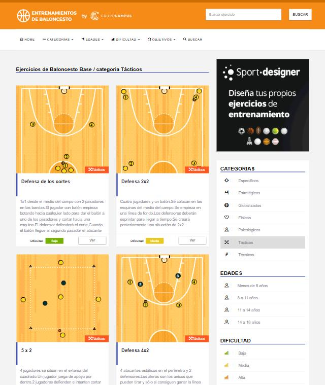
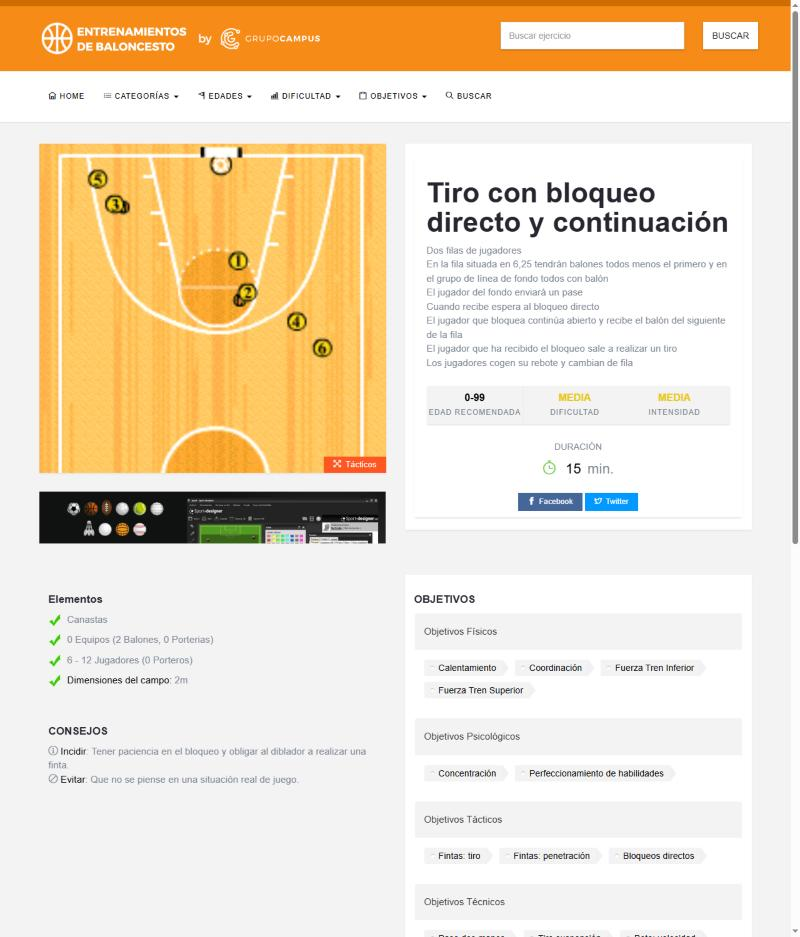
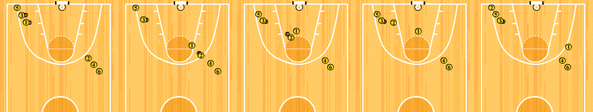
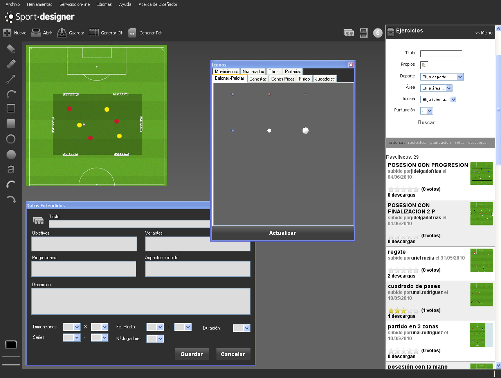

# Investigación de herramientas para crear ejercicios — Informe final

Fecha: 2026-10-04 · Método: análisis web de solo lectura (HTML, JS públicos, demos anónimas, repositorios abiertos, documentación). Sin cuentas, sin login, sin descargas. Cuatro investigaciones en paralelo (fichas completas en `fichas/`):

| Grupo | Archivo | Qué cubre |
|---|---|---|
| A | [A-baloncesto-hispano.md](fichas/A-baloncesto-hispano.md) | `entrenamientosdebaloncesto.es` a fondo y 9 herramientas hispanas |
| B | [B-baloncesto-internacional.md](fichas/B-baloncesto-internacional.md) | 12 herramientas de baloncesto (Hoop Coach, Tactical Board, FastDraw, FIBA Europe, repos de GitHub…) |
| C | [C-otros-deportes-multideporte.md](fichas/C-otros-deportes-multideporte.md) | Hockey, fútbol, rugby, multideporte (HockeyShare, Sportfica, TacticalPad…) |
| D | [D-motores-genericos-opensource.md](fichas/D-motores-genericos-opensource.md) | 9 repos deportivos abiertos con código real, Excalidraw, tldraw, animación, gestos, accesibilidad |

Etiquetas de fiabilidad (las usan las fichas): **EVIDENCIA** = visto en código o datos reales; **DEDUCCIÓN** = inferido; **NO VERIFICADO** = solo marketing o descripción.

---

## 1. Lo esencial en diez líneas

1. **Tu semilla no es lo que parece.** `entrenamientosdebaloncesto.es` no tiene editor: cada ejercicio es un **GIF animado de 200×190 px** hecho con un programa de escritorio de Windows (Sport Designer, 9,90 €) y subido como imagen. Su valor está en la **ficha y la clasificación**, no en la tecnología de dibujo.
2. **Hay cuatro formas de representar un ejercicio**, de menos a más estructurada: imagen/GIF subido → SVG generado desde datos estáticos → pasos con acciones y trayectorias → modelo completo con estado derivado (posesión, roles, validaciones). **Tu Pizarra está en el nivel más alto**, junto a Drills&Plays y los mejores repos abiertos.
3. **Los mejores proyectos convergen en la misma arquitectura** que ya usas: documento JSON en unidades reales (metros) → función pura `estado(documento, t)` → renderizador que solo lee ese estado. Pitchboard, soccer-tactics y Training Ground lo declaran por escrito. Tu `instante.js` / `fotograma.js` va en esa dirección.
4. **Nadie tiene ramas reales.** Casi todos modelan el tiempo con pasos o fotogramas y una interpolación. Tus fases con ramas, carriles y reunión de ramas no tienen equivalente en lo analizado.
5. **Varias cosas que parecen novedades ya las tienes:** duración por distancia y ritmo, longitud de arco, Bézier con manejadores, imán, deshacer, zoom y pan, plantillas de colocación y de fase, posesión del balón, frase automática, miniatura con GIF, pruebas `eval-*.mjs`.
6. **Los huecos reales** que aparecen en varias fuentes: un `validar()` de dominio, exportar e importar un ejercicio versionado, compartir por enlace, exportar vídeo o PDF, la pinza de dos dedos, accesibilidad del lienzo y una taxonomía de biblioteca más rica.
7. **Lo que más valor percibido da en el mercado es exportar y compartir** (PDF de sesión, vídeo, enlace de solo lectura). Casi todos lo cobran; para un club debería ser básico.
8. **Vocabulario y símbolos casi universales:** movimiento = línea continua con flecha; pase = discontinua; bote = ondulada o en zigzag; pantalla = línea que acaba en barra perpendicular; tiro = flecha al aro. Es lo que ya usa tu skill `basket-diagram`.
9. **Hay trampas que evitar:** animaciones falsas, píxeles como unidad, fichas emparejadas por dorsal, todas las fichas sincronizadas al final del fotograma, nubes públicas sin autenticación (detalle en la sección 6).
10. **Limitación importante:** las herramientas de pago más conocidas (TacticalPad, Sportplan, Coach Board, FastDraw) solo se pudieron ver por fuera. De ellas hay marketing, no estructura interna.

---

## 2. Cómo funcionan por dentro (patrones)

### 2.1 Cómo crean el ejercicio

| Patrón | Dónde se ve | Comentario |
|---|---|---|
| Arrastrar fichas desde una paleta y dibujar líneas con una herramienta por tipo (movimiento, pase, bote, pantalla) | Hoop Coach, Tactical Board, CourtSensei, Controla.Club, Drills&Plays | Es lo habitual. Tu anillo de acciones junto a la ficha es **más directo** que una paleta de herramientas. |
| Atajos de una tecla por herramienta | CourtSensei, Training Ground | Ya lo tienes (§4.7 de tu especificación). |
| Colocaciones y saques predefinidos | Drills&Plays (saques, zona 2-3, zona 3-2), CourtSensei, TeamBranch | Tu `plantillas.js` ya lo cubre y además guarda fases con papeles. |
| Un paso nuevo copia el anterior | TeamBranch, Tactical Board | Tus fases arrancan de la anterior. |
| Un arrastre completo es un único paso de deshacer | Pitchboard, Training Ground, tldraw, Excalidraw | Conviene comprobar que ningún gesto tuyo empuje varios pasos en `history.js`. |
| Cambiar el tipo de una flecha ya dibujada con un toque | Diagram the Game | Idea pequeña y barata. |

### 2.2 Cómo representan y qué resultado obtienen

- **Dato estructurado → SVG o canvas** (Drills&Plays con Fabric.js en el editor, Controla.Club con SVG generado por código, Pitchboard con canvas 2D). Permite buscar, reanimar, traducir y reexportar.
- **Imagen o GIF subido** (tu semilla, ejerciciosdebaloncesto.com). Es opaco: no se puede pausar, ir a un paso ni cambiar la velocidad.
- **Una sola ruta de dibujo para editor, vista previa y exportación** (Pitchboard, Training Ground, Sportfica). Así el vídeo o el PNG siempre coinciden con la pantalla.
- **Exportación en el navegador, sin servidor:** GIF con `gifenc` (o con `gif.js`, que ya usas en las miniaturas), vídeo con `MediaRecorder` o WebCodecs (sosonamo, CoachCanvas, Pitchboard, Training Ground).

### 2.3 Cómo modelan el tiempo (lo más importante para tu Pizarra)

| Modelo | Ejemplos | Resultado |
|---|---|---|
| **Fotogramas completos** (cada paso guarda la posición de todos) + interpolación lineal | Hoop Coach, Tactical Board, Basketball Play Designer, Sportfica | Fácil de editar, pero todas las fichas llegan a la vez y no se sabe qué era cambio y qué era copia. |
| **Instantánea + camino guardado en el paso al que se llega** | Pitchboard, Training Ground | Borrar un paso no deja caminos huérfanos. |
| **Transiciones por ficha dentro de una secuencia** (`startTime`, `duration`, `ease` propios) | HockeyShare | Lo más parecido a tus carriles. |
| **Disparadores por evento** («cuando B reciba el pase») y duración derivada de distancia entre ritmo | soccer-tactics, coaching-animator | Escala a jugadas reales; es el modelo hacia el que apunta tu `compilar()`. |
| **Reloj normalizado 0→1 con ventanas por trazo** | Brisbane Blackboard | Admite que no hay acciones simultáneas, justo lo que tus carriles resuelven. |

### 2.4 Trayectorias, balón y reglas

- **Trayectorias:** Bézier cúbica con 1–3 puntos de control, Catmull-Rom con 4 puntos (Drills&Plays) o listas de puntos. **El estilo de línea es un atributo independiente del camino.** Pitchboard interpola por longitud de arco; tú ya lo haces con `makeSampler`.
- **El balón como portador:** un pase es un cambio de portador y un bote es el balón pegado a quien lo lleva (Pitchboard, HockeyShare, Basketball Play Designer). Evita balones desincronizados. Tu `posesion.js` va por ahí.
- **Reglas del dominio dentro del editor:** Drills&Plays valida (solo pasa quien tiene el balón, un defensor no hace acciones ofensivas, un tiro necesita canasta) y mantiene posesión y roles derivados paso a paso. oche0809 no anima una táctica inválida y enseña el motivo.

### 2.5 Biblioteca y organización

- **Ficha estable:** título, descripción en pasos numerados, objetivo, material, jugadores (rango), duración, edad, dificultad, intensidad, espacio, variantes o progresión y «aspectos a incidir / a evitar» (la semilla los fija como bloque).
- **Taxonomía en dos ejes:** categoría (qué es) + objetivos o etiquetas (para qué sirve). La semilla tiene unos 80 tags de objetivo en 6 familias, y cada uno es un filtro con URL propia. ejerciciosdebaloncesto.com usa una **categoría primaria** y varias secundarias, con Supabase como tú.
- **Entidades separadas** (FIBA Europe): jugada, ejercicio, plan de entrenamiento y playbook, con visibilidad privada o publicada.
- **Sesiones como lista ordenada de bloques con minutos y hora de inicio calculada** (Sportfica, HockeyShare, Coach Board). Ninguna las modela como carriles solapados.
- **Comunidad con moderación:** estado `pending` → aprobado, votos, favoritos, comentarios. Probablemente no aplica a un club.

---

## 3. Contraste con tu Pizarra: lo que ya tienes y lo que falta

Revisado contra `ESPEC-PIZARRA-v3.md` y el código de `taller/js/`. Donde pone «comprobar» no lo he verificado a fondo.

| Idea del mercado | Estado en tu app |
|---|---|
| Duración por distancia y ritmo | **Ya está** (§6.2, ritmos en m/s) |
| Longitud de arco, Bézier con manejadores, mano alzada simplificada | **Ya está** (`geometry.js`, `trazo.js`) |
| Balón como estado de posesión | **Ya está** (`posesion.js`) |
| Colocaciones y fases guardadas como plantilla | **Ya está** (`plantillas.js`, §7.8) |
| Frase automática y voz | **Ya está** (`motor/frase.js`, `voz.js`) |
| Miniatura animada en GIF | **Ya está** (`canvas/thumbnail.js`, con `gif.js`) |
| Fantasmas de otras fases | Está en la especificación; comprobar en la implementación |
| Editar una fase anterior recalcula las siguientes | **Ya está** (§6.5); equivale en esencia a la «propagación» de Pitchboard |
| Vídeos de técnica por variante | **Ya está** (§10) |
| Exportar un ejercicio completo a vídeo o PDF | **No encontrado** en el taller |
| Enlace compartible de solo lectura | **No encontrado** |
| `validar()` de dominio como módulo puro y reutilizable | Comprobar si existe como tal (hay reglas de defensa en `motor/`) |
| Pinza de dos dedos | **Pendiente**; tu `PROGRESO-PIZARRA.md` ya anota que falta probar en tableta |
| Accesibilidad del lienzo (espejo DOM, `aria-live`) | **No encontrado** |
| Taxonomía rica de biblioteca (familias de objetivo, categoría primaria, «incidir / evitar») | Comprobar contra el catálogo de objetivos de la v2.1 |

---

## 4. Recomendaciones priorizadas

Valor y coste son estimaciones mías. **Ninguna se aplica sin tu aprobación**; las marcadas «decisión tuya» cambian el modelo o el diseño.

### 4.1 Prioridad alta

| # | Idea | Origen | Valor / Coste | Notas |
|---|---|---|---|---|
| 1 | **`validar()` de dominio como módulo puro** con lista `{código, mensaje, dónde}`, usado por el editor, la importación y un banco `eval-validar.mjs`. La jugada inválida no se anima y dice por qué. | oche0809, Training Ground, Drills&Plays | Alta / Fácil | Encaja con tus bancos. |
| 2 | **Exportar e importar un ejercicio** en un sobre versionado `{tipo, versión, …}` con `migrar()` antes de validar; los campos nuevos siempre opcionales. | Excalidraw, Pitchboard | Alta / Fácil | Tu v2.1 ya menciona `biblioteca.json`; esto lo generalizaría. |
| 3 | **PDF de ejercicio y de sesión** (solo diagramas, resumen de material, hora de inicio calculada). | Controla.Club, HockeyShare, Sportplan, Hoops Geek | Alta / Medio | Es lo que más se cobra en el mercado y no lo encontré en tu taller. |
| 4 | **Pinza de dos dedos y arrastre con dos dedos** en tu máquina de gestos pura, cancelando el gesto de un dedo. | MDN, Pitchboard | Alta / Medio | Falta probar en tableta. Se prueba en Node con eventos sintéticos. |
| 5 | **Ease con pendientes («corre a través»)** para que una ficha que sigue corriendo no se detenga entre fases. | Pitchboard D14 | Alta / Medio | **Hipótesis no comprobada**: el agente lo dedujo del comentario de `instante.js`. Hay que verlo en la animación antes de decidir. |
| 6 | **Variantes como cambios sobre la fase base** en vez de copias. | coaching-animator | Alta / Difícil | **Decisión tuya.** Cambia el modelo de ramas. |
| 7 | **Disparadores por evento** («cuando reciba», «al llegar a»). | soccer-tactics | Alta / Medio | **Decisión tuya.** Hay que contrastarlo con `compilar.js`, que el agente no leyó. |

### 4.2 Prioridad media

| # | Idea | Origen | Valor / Coste |
|---|---|---|---|
| 8 | **Enlace congelado de solo lectura** (`#d=` con el JSON comprimido con `CompressionStream`), sin servidor, con aviso de límite de longitud. | Pitchboard, Sportfica | Media / Fácil |
| 9 | **Exportar vídeo en el navegador** con `MediaRecorder` sobre el mismo dibujo que la pantalla; sin librerías nuevas. GIF de ejercicio completo reutilizando `gif.js`. | sosonamo, Pitchboard | Media / Medio |
| 10 | **Acciones con destinatario** («bloqueo para A3») y **opciones que no mueven el balón**. | oche0809 | Media / Fácil (comprobar contra tus acciones) |
| 11 | **Historial fusionado por gesto, con Esc que cancela, y lista nombrada** («Movido A3», «Añadido pase de 5 a 4»). | Pitchboard, soccer-tactics | Media / Fácil |
| 12 | **Biblioteca más rica:** familias de objetivo con filtro por etiqueta, categoría primaria + secundarias, bloque «Incidir / Evitar / Progresión». | Semilla, ejerciciosdebaloncesto.com | Media / Fácil |
| 13 | **Sesión por bloques arrastrables** con minutos, tipo de bloque y hora de inicio calculada. | Hoops Geek, Sportfica, HockeyShare | Media / Medio (comprobar contra tus sesiones del Tramo 3) |
| 14 | **Categorías tácticas de baloncesto** como lista cerrada (ataque, transición, ATO, SLOB, BLOB, defensa, quick hitters). | BC-Tactics | Media / Fácil |
| 15 | **Espejo DOM accesible** y la frase del motor como `aria-live`; interruptor «Reducir movimiento». | WCAG 2.5.7, ARIA Graphics | Media / Medio |
| 16 | **Imán que se desactiva al vuelo** con guías visibles; radio dependiente del zoom. | tldraw, Pitchboard | Media / Fácil |
| 17 | **Modo «yo»** en el visor del jugador: opacidad 1 / 0,75 / 0,2 según la relación con la ficha elegida. | oche0809 | Media / Fácil |
| 18 | **Fundido corto** de las anotaciones por rango de fase. | Training Ground | Media / Fácil |

### 4.3 Prioridad baja o para más adelante

- Duración por ficha con curvas `cubic-bezier` por tramo (Lottie, Theatre).
- Caché de la pista como capa estática fuera de pantalla.
- «Links» dinámicos entre jugadores (triángulos de ayuda con distancias).
- Píldora de estado de guardado: Guardado / Guardando / Error.
- Carpetas y visibilidad privado/publicado por ejercicio.
- Asistente de IA que proponga un borrador de jugada, siempre editable (HoopStrategist, HockeyShare).

---

## 5. Cómo aplicarlo: orden sugerido

1. **Fase 1, sin riesgo para el modelo:** #1 (`validar`), #2 (sobre versionado), #8 (enlace de solo lectura), #11 (historial por gesto) y #12 (biblioteca). Son módulos puros con banco de pruebas.
2. **Fase 2, valor visible para el club:** #3 (PDF de ejercicio y sesión) y #9 (vídeo). Dependen de la fase 1 (el sobre ya trae lo necesario).
3. **Fase 3, tableta y accesibilidad:** #4, #15 y #16.
4. **Fase 4, a decidir contigo con maqueta:** #5, #6 y #7. Tocan el motor de animación y el modelo de ramas, así que merecen una conversación y una prueba previa.

---

## 6. Lo que no deberíamos copiar

- **GIF de 200×190 px sin controles como único formato** (tu semilla): sirve solo como salida secundaria.
- **Coordenadas en píxeles de lienzo** (HockeyShare): atan el dato al tamaño de pantalla. Tú ya usas metros.
- **Emparejar fichas entre fotogramas por tipo, equipo y dorsal** (Sportfica): una ficha puede teletransportarse. Usa `id` estable.
- **Todas las fichas sincronizadas al final del fotograma** (tactical-board.com) o **animación estrictamente secuencial** (Brisbane): pierdes tus carriles.
- **Guardar flechas derivadas por diferencia entre fotogramas** (matthiashuschle): se pierde la intención (bote, corte, pantalla).
- **Fotogramas completos como única verdad** (Basketball Play Designer, Coach Tools): no distinguen cambio de copia.
- **Animación ficticia** (hockey-drill-board): una barra «Play» que solo hace parpadear el disco.
- **Nube pública sin autenticación** como playbook compartido (hockey-drill-board). Para compartir: enlaces congelados o Supabase con RLS.
- **Visor 3D con Three.js** (Drills&Plays, 640 KB) y **canvas opaco con Flutter** (CoachCanvas): coste alto para poco valor en baloncesto de base.
- **Librerías como dependencia** (tldraw, GSAP, Konva, Fabric, Theatre): licencias, tamaño y motores imperativos que rompen el determinismo y las pruebas en Node. Aportan vocabulario, no código.
- **Colaboración en tiempo real** (Excalidraw): un ejercicio lo edita un entrenador cada vez.
- **Límites de pasos o de ejercicios** (10, 20, 30 fotogramas; 5 jugadas gratis): son decisiones de producto, no de modelo.
- **PDF y vídeo solo en la versión de pago:** para un club deberían ser básicos.
- **IA que escribe jugadas sin revisión:** riesgo de contenido táctico incorrecto.
- **Muros de publicidad, consentimientos agresivos y un «premium» que bloquea lo básico.**

---

## 7. Límites e incidencias de esta investigación

- **Herramientas de pago no verificadas por dentro:** TacticalPad, Sportplan, Coach Board, Coach Tactic Board, FútbolSesión, bcoach, FastDraw/Hudl, planet.training y los playbooks de fútbol americano. Solo hay landing, JSON-LD y documentación pública.
- **Repos sin leer por dentro:** la API de GitHub se agotó a mitad de la pasada del grupo D (Playmaker devuelve 404; Coachable, Open Handball Tactics y SportTactic solo por README).
- **Licencias de Excalidraw, Konva, Fabric, Paper.js, SVG.js, GSAP y Theatre:** citadas de memoria, no comprobadas. Habría que verificarlas antes de adoptar nada.
- **Capturas:** solo hay 5, todas de la semilla y de su editor de escritorio (más abajo). Chrome headless se colgó con los sitios cargados de publicidad, así que no hay capturas de las demás herramientas.
- **Incidencia con tu navegador:** antes de que les avisara, dos agentes ejecutaron `taskkill` / `pkill` sobre `chrome.exe` para liberar un Chrome headless colgado. Si tenías Chrome abierto en ese momento, pudo cerrarse. No tocaron nada más fuera de `investigacion/`.
- **Nada del proyecto modificado:** solo se crearon archivos dentro de `investigacion/` (informes y capturas). No se tocó git.
- **Puntos que hay que contrastar con tu código** antes de decidir: el ease en la frontera de fase (#5) y los disparadores por evento (#7), que dependen de lo que hacen `instante.js` y `compilar.js`.

---

## 8. Capturas

Todas en `investigacion/capturas/`:

- `entrenamientosdebaloncesto-listado-tacticos.jpg` — listado por categoría.
- `entrenamientosdebaloncesto-ficha-tac0005.jpg` — ficha de un ejercicio.
- `entrenamientosdebaloncesto-gif-tac0005-fotogramas.png` y `entrenamientosdebaloncesto-gif-tec0100-fotogramas.png` — fotogramas extraídos de los GIF.
- `sportdesigner-interfaz-editor.jpg` — editor de escritorio que está detrás de la semilla (imagen de marketing).

